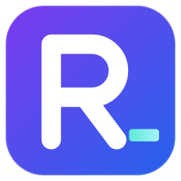
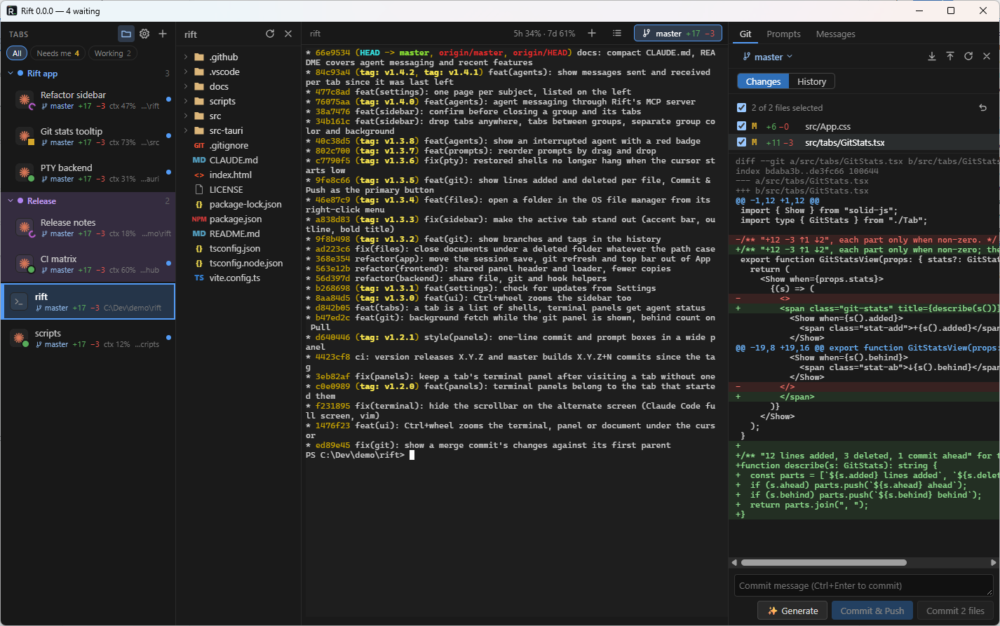
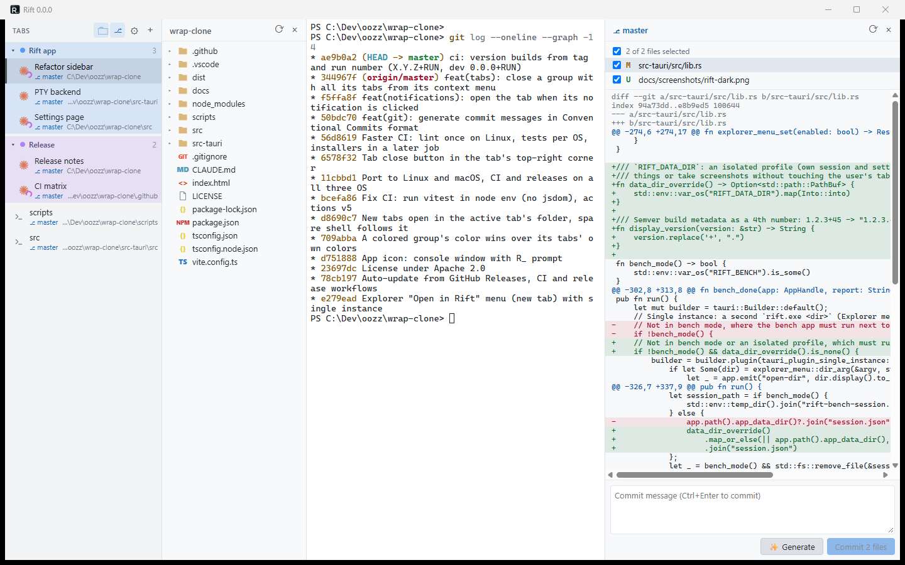

<div align="center">



# Rift

**The fast terminal for coding agents.**
Vertical tabs that switch instantly, Claude Code status on every tab, and every session back exactly where you left it.

[](https://github.com/o0Zz/rift/actions/workflows/ci.yml)
[](LICENSE)


[**Download**](https://github.com/o0Zz/rift/releases/latest) · [Features](#features) · [Shortcuts](#keyboard-shortcuts) · [Build from source](#build-from-source)



</div>

## Why Rift

You run several Claude Code sessions at once, and you jump between them all day. Rift is built for exactly
that, and **speed beats features**: every feature has to keep switching tabs and opening tabs instant.

| Measured on Windows, 20 tabs × 10,000 lines of scrollback | |
|---|---|
| Switching tabs: main-thread work (p95) | **under 16 ms**, less than one frame |
| Switching tabs: key press → tab on screen (p95) | **about 30 ms** |
| New tab | **instant**: a shell is already waiting in the current folder |
| Windows installer / app | **2.4 MB** / 7 MB |

The benchmark ships with the code (`npm run bench`: tab switching, and 8.7 MB of output printed without
freezing the window) and fails when a change goes over budget.

## Features

### Made for Claude Code
- **Status on every tab**: Claude's icon with a badge: working, done, or waiting for your permission.
- **Usage at a glance**: each Claude tab shows how full its context window is, and the top bar your 5-hour and
  weekly plan usage (Pro/Max), with reset times on hover.
- **Notifications** when a session finishes or needs you while you are elsewhere. Click one to jump to its tab;
  the taskbar icon flashes too.
- **Never lose track**: `Ctrl+Shift+U` jumps to the next tab that needs you, the sidebar filters *Needs me* /
  *Working*, and the window title counts the sessions waiting for you.
- **Parallel agents without conflicts**: *New Claude in a worktree…* creates a branch and a git worktree next to
  the repo and starts Claude there, in one click.
- **Each tab resumes its own session.** Close Rift, reopen it: every tab comes back in its folder, and each
  Claude session resumes where it was. Not the last one: the one that ran in that tab.
- **Paste screenshots into Claude**: `Alt+V` on Windows, `Ctrl+V` on macOS and Linux.
- **AI commit messages**: select files, click ✨ Generate, get a Conventional Commit written from the diff.
- Built on an agent abstraction: Codex, Gemini CLI or OpenCode can plug in next to Claude.

### Tabs that stay out of your way
- **Vertical tabs** with **named groups**: color them, collapse them, drag tabs between them.
- The tab shows what matters: Claude's conversation title, the **git branch** with its changes
  (`+12 −3`, commits ahead/behind), the folder.
- New tabs open **in the current tab's folder**, in its group.
- Instant switching with `Ctrl+PgUp` / `Ctrl+PgDn`. `F2` renames, menus work from the keyboard.
- **Your scrollback comes back** after a restart, colors included.
- Find in the scrollback, `Ctrl`+click links, zoom, `Shift+Enter` for a new line in Claude, drag a file from
  the files panel to type its path.

### Everything around the terminal
- **Files panel** with file-type icons, opened only when you want it. Delete a file or folder with the Delete key
  or its right-click menu: it goes to the Recycle Bin / Trash.
- **Open files right in the tab**: a click shows the file above your terminal, as a sub-tab. Edit code with syntax
  highlighting, save with `Ctrl+S`. Markdown opens in a reader made for reading: large text, clear headings,
  striped tables. One document at a time, or a new sub-tab per file (Settings).
- **Git panel**, one click away on the top right: branch, changed files, colored diff, commit exactly the files you check.
- **Prompts panel**: write your next prompts ahead of time, one list per repo. Click one to edit it (Enter saves,
  Shift+Enter for a new line); its ← arrow, or dragging it onto the terminal, pastes it there (you press Enter) and it leaves the list.
- Panels open and close with one shortcut and resize by dragging their edge.
- **Settings**: dark, light or system theme, terminal font, and every shortcut can be rebound.
- **Open in Rift** from the Windows File Explorer right-click menu.
- **Auto-update** from GitHub Releases: downloads in the background, installs when you close Rift.
- **Your shells**: PowerShell, Command Prompt, Git Bash or WSL on Windows; your `$SHELL` and the others
  installed on macOS and Linux. Pick the default in Settings, or right-click `+` for a one-off. Your config
  stays untouched.

<div align="center">

</div>

## Install

Download the latest version from [**Releases**](https://github.com/o0Zz/rift/releases/latest):

| OS | File |
|---|---|
| Windows 10/11 | `Rift_x.y.z_x64-setup.exe` |
| macOS (Apple Silicon and Intel) | `Rift_x.y.z_universal.dmg`: not signed yet, allow it once in *System Settings → Privacy & Security* |
| Linux | `.AppImage` (updates itself) or `.deb` |

Installed copies update themselves.

### Turn on the Claude Code integration
On first launch Rift offers **Enable**: it adds Rift's hooks to `~/.claude/settings.json` (your other settings
are kept, and a `.bak` copy is written). Claude sessions started after that get status icons,
notifications and per-tab resume. Without Claude Code, Rift is simply a fast terminal.

## Keyboard shortcuts

| Action | Default |
|---|---|
| New tab (in the current folder) | `Ctrl+Shift+T` |
| Close tab | `Ctrl+Shift+W` |
| Next / previous tab | `Ctrl+PgDn` / `Ctrl+PgUp`, `Ctrl+Tab` / `Ctrl+Shift+Tab` |
| Files panel | `Ctrl+Shift+E` |
| Git panel | `Ctrl+Shift+G` |
| Prompts panel | `Ctrl+Shift+O` |
| Next tab that needs you | `Ctrl+Shift+U` |
| Find in terminal | `Ctrl+Shift+F` |
| Zoom in / out / reset | `Ctrl+=` / `Ctrl+-` / `Ctrl+0` |
| Rename tab | `F2` |
| Refresh the files and git panels | `F5` (never reloads Rift) |
| Settings | `Ctrl+,` |
| Copy / paste | `Ctrl+C` (with a selection) / `Ctrl+V` |

All of them can be changed in Settings. `Ctrl+T` and `Ctrl+W` are left to your shell and to Claude Code.
On macOS the defaults use `Cmd` instead of `Ctrl`.

## Build from source

Requirements: [Node.js](https://nodejs.org) 22+, [Rust](https://rustup.rs) stable, and on Linux the
[Tauri system packages](https://tauri.app/start/prerequisites/).

```sh
npm ci
npm run tauri dev       # run with live reload
npm test                # frontend tests
cd src-tauri && cargo test
npm run tauri build     # installer for your OS
```

Rift is built with [Tauri 2](https://tauri.app) (Rust) and [xterm.js](https://xtermjs.org), with
[Solid](https://www.solidjs.com) for the UI. `CLAUDE.md` describes the architecture and the design decisions.

## License

[Apache License 2.0](LICENSE)
